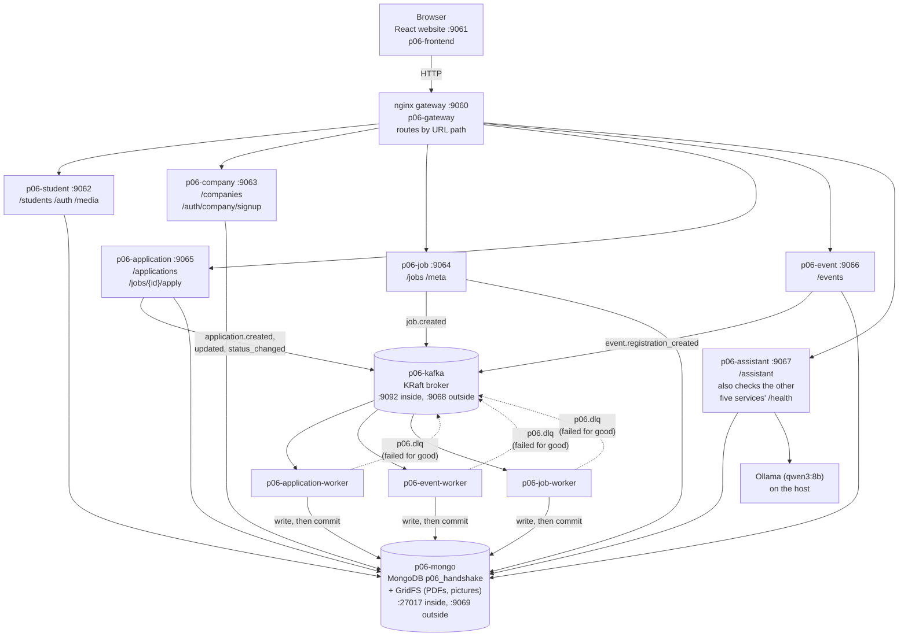
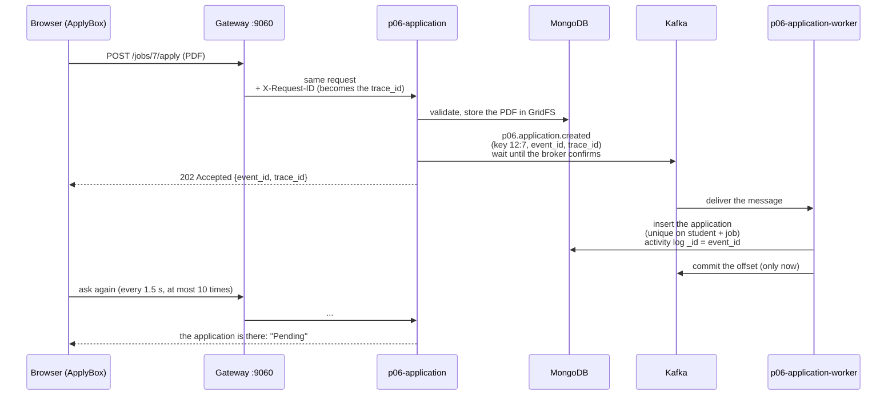
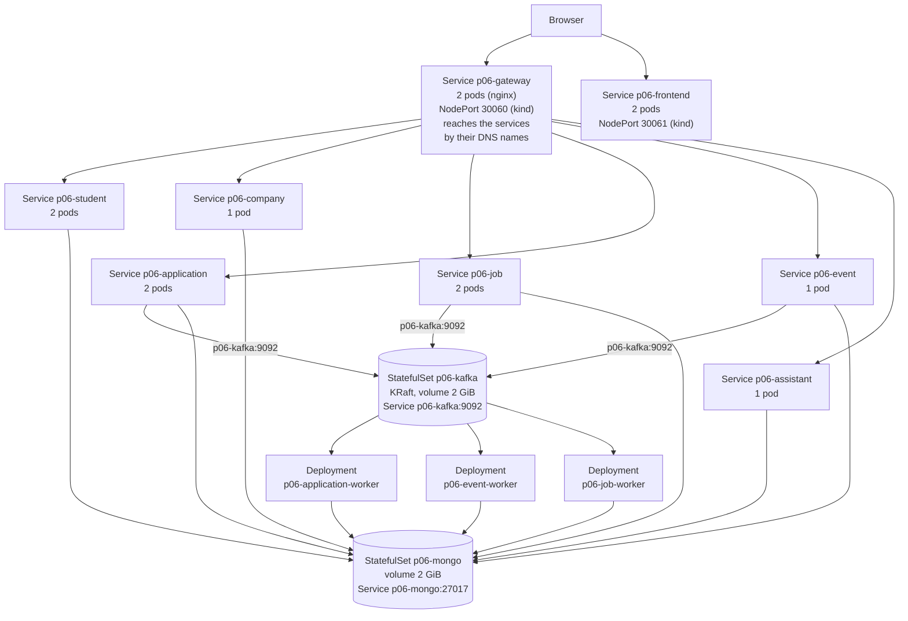

# Architecture (Pair 06, Lab 2)

Everything below runs from `docker-compose.yml` (the same images go to Kubernetes). Names and ports are the real ones.

## 1. Containers and who talks to whom

## 2. The apply flow (asynchronous, 202)

If the worker is killed between the insert and the commit, Kafka delivers the message again after the restart and the handler finds
the application already there (`duplicate`). Messages that can never work, or still fail after 3 attempts, are copied to `p06.dlq`
before their offset is committed (see `KAFKA_CONTRACT.md`, sections 3, 4 and 7).

## 3. Topics

| Topic | Producer | Consumer |
|---|---|---|
| `p06.application.created` | p06-application (`POST /jobs/{id}/apply`) | p06-application-worker |
| `p06.application.updated` | p06-application (`PUT /applications/{id}/resume`) | p06-application-worker |
| `p06.application.status_changed` | p06-application (`PATCH /applications/{id}/status`) | p06-application-worker |
| `p06.event.registration_created` | p06-event (`POST /events/{id}/register`) | p06-event-worker |
| `p06.job.created` | p06-job (`POST /jobs`) | p06-job-worker |
| `p06.dlq` | the three workers | a person |

## 4. The same system in Kubernetes (namespace `p06-handshake`, manifests in `k8s/`)

Each box is a Kubernetes Service (a stable DNS name and address that spreads requests over the ready pods behind it) or the workload
behind it. The three workers have no Service because nothing calls them: they read from Kafka. Every service and worker pod also reads the
ConfigMap `p06-config` and the Secret `p06-secrets` (not in git) as environment variables; those links are not drawn, to keep the diagram readable.
