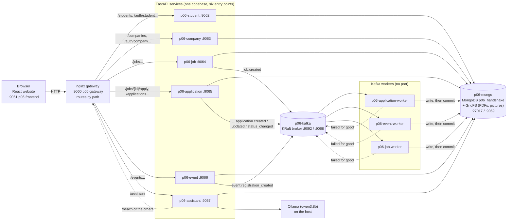
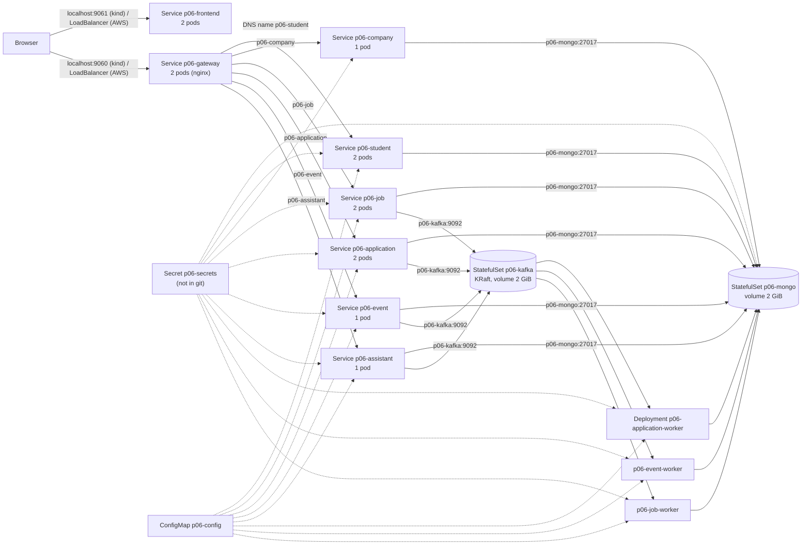

# Architecture (Pair 06, Lab 2)

Everything below runs from `docker-compose.yml` (the same images go to Kubernetes). Names and ports are the real ones.

## 1. Containers and who talks to whom



## 2. The apply flow (asynchronous, 202)

```mermaid
sequenceDiagram
    participant B as Browser (ApplyBox)
    participant G as Gateway :9060
    participant A as p06-application
    participant M as MongoDB
    participant K as Kafka
    participant W as p06-application-worker

    B->>G: POST /jobs/7/apply (PDF)  X-Request-ID = trace_id
    G->>A: same request
    A->>M: validate, store the PDF in GridFS
    A->>K: p06.application.created (key 12:7, event_id, trace_id) and wait for the broker to confirm
    A-->>B: 202 Accepted {event_id, trace_id}
    K->>W: deliver the message
    W->>M: insert the application (unique on student+job); activity log _id = event_id
    W->>K: commit the offset (only now)
    B->>G: ask again (every 1.5 s, at most 10 times)
    G->>A: ...
    A-->>B: the application is there: "Pending"
```

If the worker is killed between the insert and the commit, Kafka delivers the message again after the restart and the handler finds
the application already there (`duplicate`). Messages that can never work, or still fail after 3 attempts, are copied to `p06.dlq`
before their offset is committed (see `KAFKA_CONTRACT.md`, sections 3, 4 and 7).

## 3. Topics

| Topic | Producer | Consumer |
|---|---|---|
| `p06.application.created` | p06-application (`POST /jobs/{id}/apply`) | p06-application-worker |
| `p06.application.updated` | p06-application (`PUT /applications/{id}/resume`) | p06-application-worker |
| `p06.application.status_changed` | p06-application (`PATCH /applications/{id}/status`) | p06-application-worker |
| `p06.event.registration_created` | p06-event (`POST /events/{id}/register`) | p06-event-worker |
| `p06.job.created` | p06-job (`POST /jobs`) | p06-job-worker |
| `p06.dlq` | the three workers | a person |

## 4. The same system in Kubernetes (namespace `p06-handshake`, manifests in `k8s/`)



Each box is a Kubernetes Service (a stable DNS name and address that spreads requests over the ready pods behind it) or the workload
behind it. The three workers have no Service because nothing calls them: they read from Kafka.
